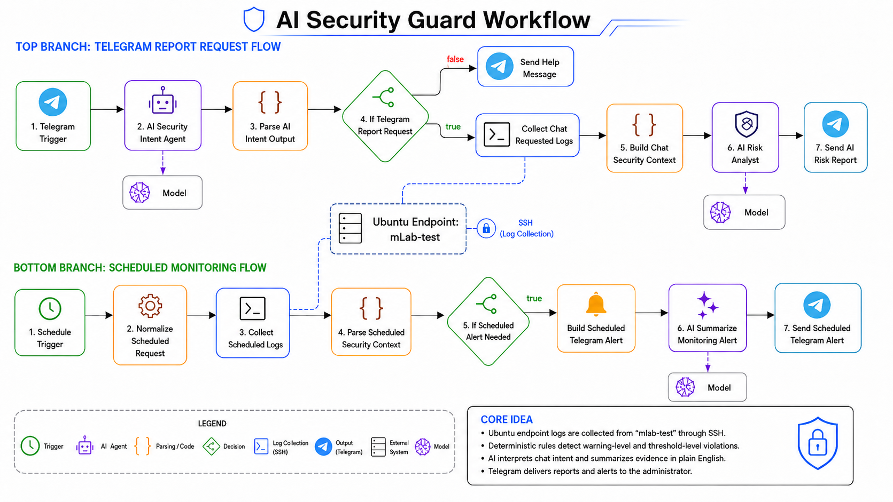

# AI Security Guard – Ubuntu Security Monitoring Workflow

## Overview

The AI Security Guard is the systems security monitoring component of the AI-driven infrastructure management project. It monitors a simulated company Ubuntu endpoint called `mlab-test` for policy-warning activity, unauthorized command attempts, and users who repeatedly attempt restricted actions.

The workflow combines Linux security logs, `auditd` audit rules, custom warning scripts, n8n automation, SSH-based log collection, Telegram notifications, and AI-generated security explanations.

The system does not rely on AI to blindly decide what is dangerous. Linux logs and deterministic rules detect the actual activity first. The AI layer then explains the evidence in plain English and recommends the next administrator action.

```text
Rules detect.
n8n validates and orchestrates.
AI interprets and explains.
Telegram delivers the report.
```

## Workflow Overview



**Figure:** AI Security Guard workflow showing the Telegram report request branch, scheduled monitoring branch, Ubuntu SSH log collection, AI analysis, and Telegram report delivery.

## Purpose

This module demonstrates how a company-managed Ubuntu endpoint can be monitored for:

- repeated restricted software installation attempts;
- unauthorized sudo usage;
- execution of monitored administrative tools;
- policy-warning events;
- user activity over selected timeframes such as `today`, `last 1 hour`, or `last 5 days`;
- users who cross an administrator-review threshold.

## Monitored Ubuntu Endpoint

```text
Host: mlab-test
Operating system: Ubuntu
Role: Simulated company-managed endpoint
```

The endpoint contains test users representing different workplace roles:

| User | Role |
|---|---|
| `mlab-admin` | Administrator user with sudo privileges |
| `employee1` | Trusted employee with sudo privileges |
| `employee2` | Normal employee without sudo privileges |
| `employee3` | Normal employee without sudo privileges |
| `intern1` | Restricted intern account |
| `contractor1` | Restricted contractor account |

Users are organized into company-style groups:

```text
company-admins
company-employees
company-interns
company-contractors
policy-violators
```

## Security Tools Used

| Tool / Component | Purpose |
|---|---|
| `/var/log/auth.log` | Tracks sudo attempts, authentication failures, and policy warnings |
| `journalctl` | Reads recent system events by timeframe |
| `auditd` | Linux audit daemon for monitoring command execution and sensitive file changes |
| `ausearch` | Searches audit logs by audit rule key |
| `company-warning` | Custom warning script shown to restricted users |
| `collect-company-logs.sh` | Collects system logs, audit events, and policy summaries |
| `check-policy-violations.sh` | Calculates per-user violation counts |
| `n8n` | Orchestrates the workflow |
| `Telegram` | Administrator interface |
| `AI Risk Analyst` | Summarizes evidence in plain English |

## Detection Logic

The workflow uses deterministic detection rules.

```text
0 violations        → clean
1–4 violations      → warning-level activity
5+ violations       → needs administrator review
```

Example structured output:

```text
USER=intern1
status=NEEDS_ATTENTION
policy_warnings=8
software_install=8
total_violations=8
```

## Workflow Branches

### 1. Telegram Report Request Flow

This branch starts when the administrator sends a Telegram message.

Example messages:

```text
report today
report last 1 hour
show warnings for employee2
which users need attention?
why was employee2 flagged?
```

Workflow path:

```text
Telegram Trigger
→ AI Security Intent Agent
→ Parse AI Intent Output
→ If Telegram Report Request
→ Collect Chat Requested Logs
→ Build Chat Security Context
→ AI Risk Analyst
→ Send AI Risk Report
```

The AI Security Intent Agent interprets the administrator’s natural-language request and converts it into structured workflow input.

Example interpreted request:

```json
{
  "mode": "chat",
  "host": "mlab-test",
  "timeframe": "today",
  "requestType": "user_warnings",
  "userFilter": "employee2",
  "isReportRequest": true
}
```

If the request is valid, n8n collects logs from the Ubuntu endpoint through SSH.

Example SSH command:

```bash
sudo -n /usr/local/sbin/collect-company-logs.sh "today"
```

The AI Risk Analyst then explains the structured evidence in plain English.

### 2. Scheduled Monitoring Flow

This branch runs automatically at a fixed interval.

Workflow path:

```text
Schedule Trigger
→ Normalize Scheduled Request
→ Collect Scheduled Logs
→ Parse Scheduled Security Context
→ If Scheduled Alert Needed
→ Build Scheduled Telegram Alert
→ AI Summarize Monitoring Alert
→ Send Scheduled Telegram Alert
```

If no user reaches the threshold, the workflow stops silently. If a user reaches five or more violations, the workflow sends a Telegram alert to the administrator.

## Quick Start

1. Install the Ubuntu security dependencies.
2. Copy the scripts from `scripts/` into `/usr/local/sbin/` or `/usr/local/bin/` as shown in `setup.md`.
3. Copy the audit rules from `audit/company-monitor.rules` into `/etc/audit/rules.d/company-monitor.rules`.
4. Reload audit rules.
5. Connect n8n to the Ubuntu endpoint using SSH.
6. Import or rebuild the n8n workflow using the notes in `n8n/workflow-notes.md`.

## Key Design Principle

```text
Linux logs and audit rules detect events.
n8n validates and controls execution.
AI explains the evidence.
Telegram delivers the result.
```
